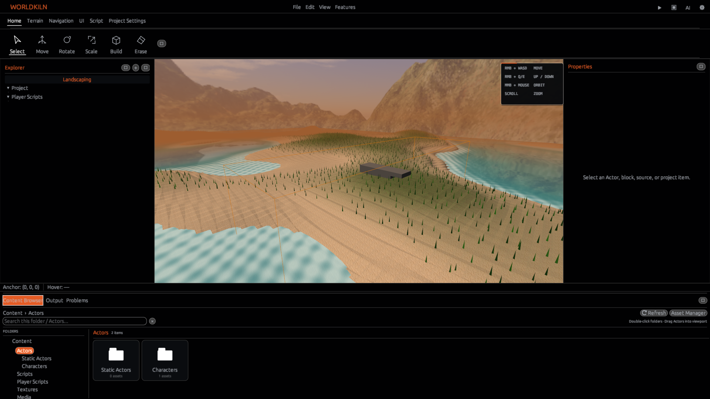
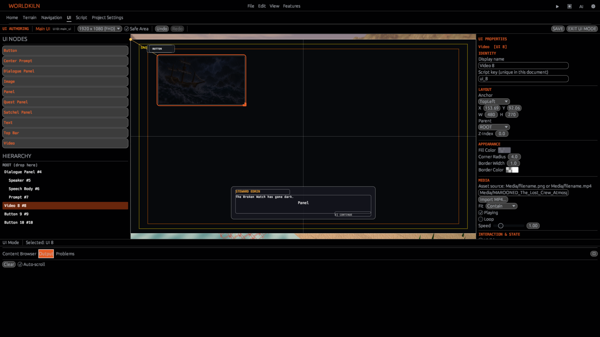

# Worldkiln

### Make it yours.

**Build worlds. Bring them to life. Make a game of your own.**


Worldkiln is a game engine and visual editor for Windows. Shape landscapes, build with Cells, fill your world with characters and objects, create your own gameplay with **AeoScript**, and see it all come to life in **Play mode**.

From a quiet island to an adventure full of moving parts, Worldkiln gives you the tools to create something that's yours.

**[Download Worldkiln](https://github.com/Aeowun/Worldkiln/releases)** · **[Explore Features](FEATURES.md)** · **[Getting Started](https://aeowun.com/worldkiln/getting-started/)** · **[Documentation](https://aeowun.com/docs/)**

---

## Make a world that feels alive

### Water that reacts to your world

Create oceans and shorelines with moving waves, ripples, wakes, and foam that respond to objects in the water. Shoreline wash and changing wetness help water meet the land more naturally, while underwater camera effects give submerged scenes their own atmosphere.

### Build, sculpt, and explore

Use Cells for precise construction or shape larger landscapes with terrain generation, sculpting, painting, and material layers. Bring scenes together with lighting, sky, fog, and atmospheric effects.

### Populate it with characters and objects

Import 3D models, place Actors, and bring animated characters into your world. Arrange props and game objects in the editor, configure their properties, and create interactions with physics and scripts.

### Give your game its own rules with AeoScript

AeoScript is Worldkiln's built-in gameplay language. Create player controls, cameras, interactions, events, UI, sound, and game logic using `.aeo` scripts—without leaving your project.

```aeoscript
debug.log("Welcome to my world!")

on on_touch(other) {
    debug.log("Something touched this object!")
}
```

**[Explore AeoScript](AEOSCRIPT.md)** · [AeoScript documentation](https://aeowun.com/aeoscript/)

### Create effects and atmosphere

Add particles and effects such as fire and smoke, work with materials to shape how surfaces look, and use audio emitters to give places and objects their own sound.

### Press Play. Keep creating.

Switch between building and Play mode to try out movement, collisions, interactions, cameras, and game UI. When your game is ready, build a standalone Windows game that can run independently of the Worldkiln editor.

---

## Inside the editor



Worldkiln brings world building, landscaping, scripting, UI design, and project assets together in one workspace. The Project Explorer helps organize your scenes and scripts, while the Content Browser makes it easy to find assets and place them into your world.



## Get started

1. **Download** Worldkiln for Windows from the [Releases page](https://github.com/Aeowun/Worldkiln/releases).
2. **Install and launch** Worldkiln, then create or open a project.
3. **Build a scene** with Cells, landscaping, Actors, materials, and lighting.
4. **Add gameplay** using AeoScript, then press **Play** to try it.
5. **Build your game** when you're ready to share it.

For a guided introduction, visit [Getting Started](https://aeowun.com/worldkiln/getting-started/).

## About BETA features

**BETA means included, not unavailable.** Features marked **BETA** are part of Worldkiln and can be used in your projects. They are still being refined, so you may encounter bugs, rough edges, or changes between updates. Save backups of projects you care about.

## More from Worldkiln

[**Features**](FEATURES.md) · [**User Guide**](DIVE.md) · [**Documentation**](https://aeowun.com/docs/) · [**AeoScript Guide**](AEOSCRIPT.md) · [**Changelog**](CHANGELOG.md) · [**Founding Developer Program**](FOUNDING_DEVELOPERS.md) · [**Support**](https://aeowun.com/support/) · [**Support Worldkiln on Ko-fi**](https://ko-fi.com/aeowun/tip)

---

**Worldkiln is the tool. Your game is the product.**

See the [license](LICENSE) for terms of use.
