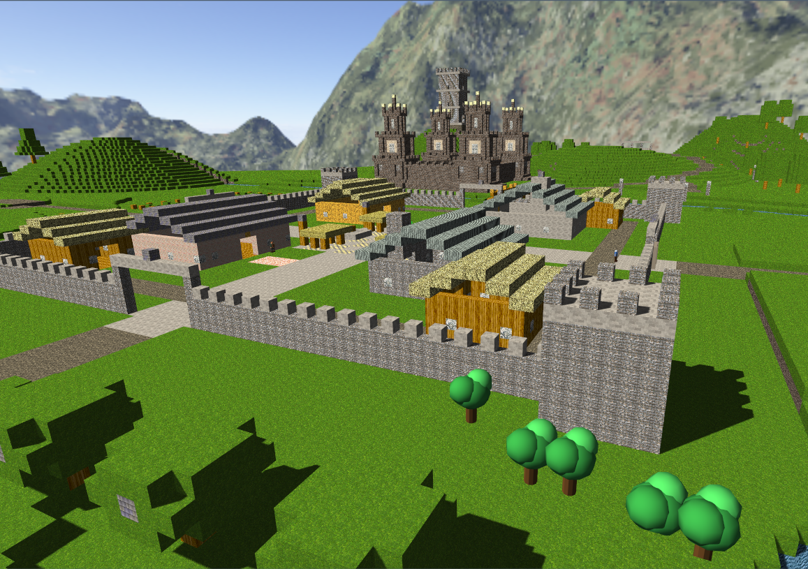
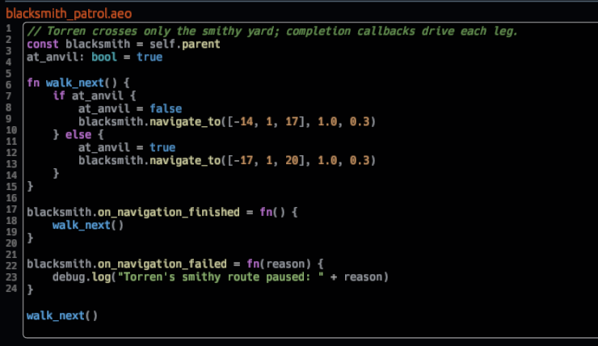

# Worldkiln in action

Scenes, characters, and editor screenshots from Worldkiln. These are examples of the engine and its tools, **not a list of independently published games**.

[Explore features](FEATURES.md) · [Download Worldkiln](https://github.com/Aeowun/Worldkiln/releases) · [Getting started](https://aeowun.com/worldkiln/getting-started/)

## Built environments

*Fortress scene.*

*Castle scene.*

## Actors and characters

*An Actor in the Worldkiln editor.*

*Blacksmith patrol scene.*

## The editor

*World editor.*

*UI authoring.*

---

Some screenshots document earlier Worldkiln versions; they show real examples rather than every newer BETA feature. A separate gallery of completed games can grow as released Worldkiln projects become available.

[All features](FEATURES.md) · [AeoScript](AEOSCRIPT.md)
